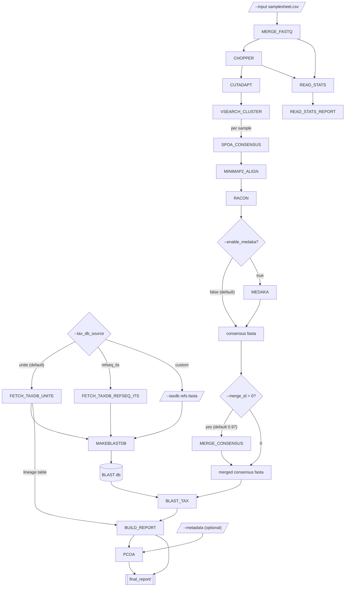

# ITS-nf

A Nextflow (DSL2) pipeline for classifying Oxford Nanopore fungal ITS
amplicon data (ITS1/ITS4) from communities such as soil: vsearch identity
clustering + spoa/racon/medaka consensus + UNITE/RefSeq BLAST taxonomy
assignment, plus Bray-Curtis/PCoA beta diversity.

Forked from [16S-nf](https://github.com/ehill-iolani/16S-nf) v0.3.1. The
steps are the same; what changes for ITS is:

- **References.** UNITE (all eukaryotes, with lineage) or NCBI RefSeq fungal
  ITS, instead of SILVA / RefSeq 16S.
- **Read-length window.** 300-1500 bp for ITS1/ITS4 amplicons, instead of
  1200-1800 bp for full-length 16S.
- **Query coverage.** ITS1 and ITS2 sit between conserved 18S / 5.8S / 28S
  stretches, so a sequence from an organism missing from the reference can
  still hit something at high identity over the ~160 bp 5.8S alone. Hits
  covering under `--min_qcov` % of the consensus are flagged `low_coverage`.
- **Consensus length.** spoa builds the draft in global mode (`-l 1`); its
  default local mode doubled part of many ITS drafts. A consensus longer than
  the longest read in its cluster can't be a real amplicon, and is flagged
  `long_consensus`.
- **Hit ranking.** The best hit is the highest-identity one that passes the
  coverage check, not the highest bitscore: UNITE's sequences differ in length,
  and bitscore favours longer references over closer ones.
- **Near-ties.** Species within `--tie_pident` percentage points of the best
  identity count as tied, and tied species are reported at genus level. ITS
  can't separate some close species (Aspergillus section Nigri, much of
  Penicillium).

The output keeps 16S-nf's (and edna-ont-nf's) `abundance_table.tsv` schema,
plus a `qcovs` column, so the iolani-bioinformatics frontend's charts work
against it.

## Requirements

- [Nextflow](https://www.nextflow.io/) >= 23.10.0
- One of Docker, Singularity, or Conda (every process is containerized; pick
  a profile below)

## Quickstart

```bash
nextflow run main.nf \
  --input samplesheet.csv \
  -profile docker
```

`samplesheet.csv` is a two-column CSV:

```csv
sample,fastq
soil_1,data/barcode01/*.fastq.gz
genki_1,data/barcode02/*.fastq.gz
```

`fastq` may be a single file or a glob matching multiple part-files (they're
merged per sample before filtering). Glob paths resolve relative to the
launch directory, not the samplesheet's location. Reads may be in either
orientation (e.g. native barcoding with your own ITS1/ITS4 PCR).

The reference is chosen with `--tax_db_source`:

| `--tax_db_source` | Reference |
|---|---|
| `unite` (default) | [UNITE](https://unite.ut.ee/) 10.0 general FASTA release for **all eukaryotes** (~142,000 species-hypothesis sequences). Writes each hit's kingdom-to-genus lineage to the abundance table |
| `refseq_its` | NCBI RefSeq targeted-loci fungal ITS (~20,000 curated sequences, mostly from type material). Fungi only, no lineage |
| `custom` | Whatever FASTA `--taxdb` points to (headers `>id Genus species ...`) |

The all-eukaryotes UNITE release is the default because ITS1/ITS4 also
amplify plant (and some animal and protist) ITS, which soil samples are full
of. Against a fungi-only reference those reads come back as poor fungal
matches or no hit. With UNITE they're named as what they are, and the
`kingdom` column separates them from the fungi.

`unite`/`refseq_its` need network access from wherever the pipeline runs, and
cache the downloaded fasta under `--tax_db_cache` (default
`assets/tax_db_cache/`) so it's fetched once and reused on later runs.

UNITE's own headers
(`Fusarium_oxysporum|MH865823|SH1166021.10FU|reps|k__Fungi;p__...`) are
rewritten by `bin/unite_to_blast.awk` to `>MH865823 Fusarium oxysporum
SH1166021.10FU`, with the lineage in a side table
(`unite_10_euk_taxmap.tsv`). A record UNITE couldn't name to species is
labelled `Genus sp.`, or by its lowest named rank (`Agaricaceae (family)`).
To use a different UNITE release as `--taxdb custom`, convert it the same way
first.

Optionally, `--metadata metadata.csv` (`sample,<any columns>`, e.g.
`sample,source,site`) gets joined onto the PCoA output for coloring points by
group/site/etc. in the frontend. It has no effect on classification.

## Parameters

| Parameter | Default | Description |
|---|---|---|
| `--input` | *(required)* | Samplesheet CSV (`sample,fastq`) |
| `--tax_db_source` | `unite` | Reference database: `unite`, `refseq_its` (both auto-download and cache), or `custom` (use `--taxdb`) |
| `--taxdb` | *(required if `--tax_db_source custom`)* | ITS reference sequences FASTA; a BLAST db is built from this each run |
| `--tax_db_cache` | `assets/tax_db_cache` | Where auto-downloaded reference databases are cached between runs |
| `--outdir` | `results` | Output directory |
| `--fwd_primer` / `--rev_primer` | `null` | Primer sequences (both 5'->3', as ordered) for cutadapt trimming; skipped if unset (classification doesn't need it). Reads in either orientation are trimmed, reads without both primers are dropped |
| `--min_len` / `--max_len` / `--min_qual` | `300` / `1500` / `10` | chopper length/quality filtering thresholds, sized for ITS1/ITS4; narrow for ITS1- or ITS2-only primers |
| `--enable_read_stats` | `true` | Read length and Q-score summary before vs. after filtering; purely informational |
| `--cluster_id` | `0.86` | vsearch identity threshold for read clustering |
| `--min_cluster` | `5` | Minimum reads in a read-level cluster to attempt consensus |
| `--spoa_max_reads` | `500` | Most reads per cluster used for the spoa draft, taken evenly through the cluster (`0` = all). RACON still polishes with every read, and `cluster_size` counts every read |
| `--merge_id` | `0.97` | Identity at which per-cluster consensus sequences are merged; `0` skips the merge |
| `--enable_medaka` | `false` | Use medaka-polished consensus instead of the racon consensus downstream |
| `--blast_chunk_size` | `300` | Consensus sequences per `BLAST_TAX` task, so a sample with thousands of clusters is searched on several VMs side by side (`0` = one task per sample). The hits are the same either way |
| `--min_pident` | `90` | Best hits below this %identity are flagged `low_identity`, not dropped |
| `--min_qcov` | `70` | Best hits covering less than this % of the consensus (BLAST `qcovs`) are flagged `low_coverage`, not dropped; `0` = off |
| `--tie_pident` | `1.0` | Hits within this many percentage points of the best identity count as tied (`tied_taxa`); `0` = exact ties only |
| `--min_abundance` | `20` | Merged clusters with fewer reads than this get `low_abundance = true`, not dropped (`0` = off) |
| `--min_rel_abundance` | `0` | ...or with a smaller fraction of the sample's clustered reads (`0` = off) |
| `--metadata` | `null` | Optional CSV (`sample,<columns>`) joined onto the PCoA output for coloring |
| `--container_registry` / `--dockerhub_registry` | `quay.io` / `docker.io` | Registries the images are pulled from; the `google_batch` profile points both at the Artifact Registry mirror |

All defaults live in `nextflow.config`, not `main.nf` (see the comments
there if you're adding a new one).

## Pipeline



1. `FETCH_TAXDB_UNITE` / `FETCH_TAXDB_REFSEQ_ITS` -- download (once, cached) and prepare the reference
2. `MAKEBLASTDB` -- build a BLAST db (once per run)
3. `MERGE_FASTQ` -- merge multi-part fastq(.gz) files per sample
4. `CHOPPER` -- length/quality filter (`READ_STATS` side branch summarizes before vs. after)
5. `CUTADAPT` -- primer trimming (skipped if no primers supplied, the default)
6. `VSEARCH_CLUSTER` -- de novo identity clustering, both strands
7. `SPOA_CONSENSUS` (draft from at most `--spoa_max_reads` reads), `MINIMAP2_ALIGN` + `RACON` (+ optional `MEDAKA`) -- consensus per cluster
8. `MERGE_CONSENSUS` -- folds near-identical cluster consensus sequences back together
9. `BLAST_TAX` -- blastn per chunk of `--blast_chunk_size` consensus sequences, up to 50 targets per cluster, with `qcovs`; `BUILD_REPORT` joins each sample's chunks back into `07_taxonomy/{sample}.hits.tsv`
10. `BUILD_REPORT` -- best hit, near-ties and flags per cluster; abundance table + QC summary; consensus fastas gathered by confidence
11. `PCOA` -- Bray-Curtis distance + classical PCoA across samples, optionally joined with `--metadata`

## Output layout

```
results/
  {sample}/                    per-step intermediates, as in 16S-nf
    07_taxonomy/               BLAST hits ({sample}.hits.tsv)
  blastdb/
  consensus_by_confidence/
    confident/                 passed the coverage and identity checks
    low_confidence/            long_consensus, low_coverage or low_identity
    no_hit/                    no BLAST hit at all
  final_report/
    abundance_table.tsv        one row per cluster (see below)
    run_qc_summary.html
    read_qc_summary.html, read_stats.tsv, read_length_qscore_hist.tsv
    pcoa_coordinates.tsv
  pipeline_info/
```

`abundance_table.tsv` columns: `seq_id, sample, cluster_size, subject_id,
pident, length, evalue, bitscore, qcovs, stitle, tied_taxa`, then (UNITE
only) `kingdom, phylum, class, order, family, genus`, then `flag_reason`
(`''`, `no_hit`, `long_consensus`, `low_coverage` or `low_identity`, checked
in that order) and `low_abundance`.

## Testing

```bash
nextflow run main.nf -profile test,docker
```

runs the small synthetic dataset in `tests/data/` (structural sequences, not
real ITS) against `tests/data/test_refs.fasta` as a `custom` reference. It
exercises pipeline mechanics only.

## Container mirror

Same images as 16S-nf, so the shared Artifact Registry mirror already holds
them; see 16S-nf's README and `scripts/mirror_images.sh --check`.
